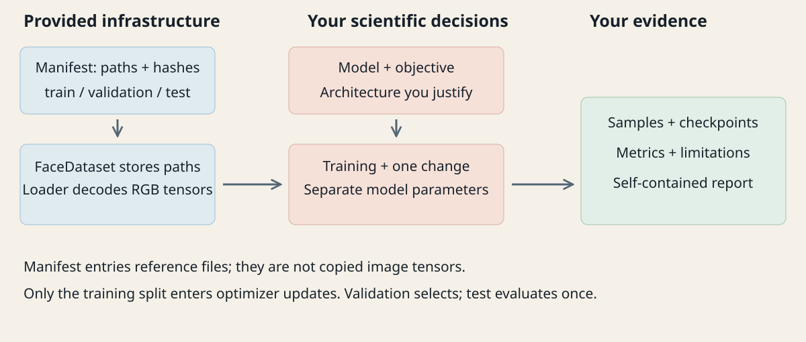
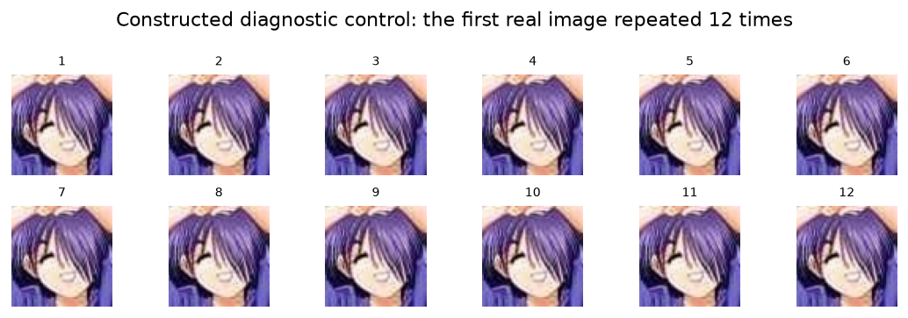
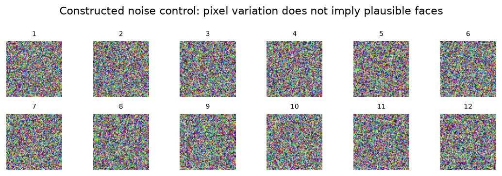

:::{.project-brief}
<strong>Format:</strong> Independent take-home
<strong>Prerequisites:</strong> VAE + GAN chapters
<strong>Data:</strong> Kaggle anime faces
<strong>Submit:</strong> Notebook + experimental report
:::

## Your task

**Design a model that generates RGB anime faces from random codes, then defend one design decision with evidence.** Choose a VAE or GAN, implement and train it, and compare a baseline with one controlled variant. Explain your choices, preserve failures, and distinguish what you measured from what you suspect.

The earlier labs supplied much of the model and training structure. Here those decisions belong to you. Data preparation, plotting, logging, diagnostic calculations and report formatting are provided. There is no supplied trained solution and no required image-quality score.

[Read the notebook and visual guidance](reading.qmd){.btn .btn-primary}

<a class="btn btn-secondary" href="starter/anime_faces_homework.ipynb?download=1" download="anime_faces_homework.ipynb">Download homework notebook</a>

[Download starter ZIP](assets/anime-homework.zip){.btn .btn-secondary}

<a class="btn btn-secondary" href="assets/_report-template.qmd" download="report_template.qmd">Download Quarto report template</a>

{fig-alt="Twelve real anime-face crops showing different hair colors, poses, expressions and backgrounds."}

## Freedom with a clear scientific contract

| You decide and implement | Provided support |
|---|---|
| VAE or GAN and a reasoned justification | Kaggle access instructions and portable RGB loader |
| Architecture, latent dimension, capacity and output range | Seeded split and exact processed-duplicate audit |
| Objective, optimizer updates and training procedure | Scalar logging, checkpoint serialization and plots |
| One controlled change and a prediction before training | Sample grids and transparent pixel-distance diagnostics |
| Interpretation, model selection and limitations | Self-contained HTML report renderer and Quarto template |

Use course concepts [@kingma2014vae; @goodfellow2014gan; @radford2015dcgan]. More complicated methods are not required. Cited adaptation is welcome; students must explain the code they use. The assignment concerns unconditional generation, not photo-to-anime translation or prompts to a pretrained generator.

{fig-alt="Provided data manifest and loader feed student-designed models and training, then samples, metrics and limitations feed the report."}

## Data and realistic scope

Use [Anime Face Dataset on Kaggle](https://www.kaggle.com/datasets/splcher/animefacedataset), handle `splcher/animefacedataset` [@splcher2019animefaces]. Attach it in Kaggle, download with KaggleHub, or use an extracted local copy. The notebook includes all three routes. Measure your downloaded counts and report the source/version or access date, exclusions, preprocessing, and split. The data description and actual file listing can differ; copy neither count uncritically.

Plan about **4–6 hours of active work**, with hardware-dependent training time. Begin at 32 × 32 or 64 × 64 and use a reproducible subset. Set your step/time caps before running both configurations. A reduced CPU investigation is acceptable; there is no requirement to buy compute or achieve a particular visual score. The final two course weeks remain reserved for project presentations; exact dates and submission arrangements are announced separately.

The provided split removes exact equality after preprocessing before partitioning; related characters and near duplicates can remain. Discuss this limitation and the source dataset's selection biases. Do not bundle the dataset with your submission.

## What must appear in the report

Submit an executed notebook, **report.html**, manifest, configurations, logs, evaluation records and model weights. Aim for roughly **1,200–1,800 words plus figures**; use a figure appendix if needed. The report must stand alone.

1. **Question:** model choice, initial hypothesis, and the single factor tested.
2. **Dataset:** source, measured audit, preprocessing, split, exclusions and biases.
3. **Architecture:** your diagram, tensor dimensions, parameter counts, objective formulas and reductions.
4. **Training:** hardware/software, seeds, optimizers, learning rates, batch size, actual updates/time, mode policy and checkpoint selection.
5. **Results and metrics:** controlled A/B comparison, curves, fixed-code history, uncurated samples, quantitative diagnostics and nearest training-image pairs.
6. **Limitations and conclusion:** supported findings, failed cases, alternative explanations and one next experiment.
7. **References:** papers, dataset, adapted code and external assistance.

The notebook exports a self-contained HTML report with embedded figures. It also explains Quarto HTML/PDF rendering and notebook-to-HTML export. Report prose and conclusions remain student work.

## Metrics must support a claim

Use the supplied pairwise pixel-MSE and nearest-image checks alongside fresh samples and loss history. Report counts, resolution, reference selection and preprocessing. The controls below show why a number alone is insufficient: exact repetition has zero variation, while random noise can have more pixel variation than plausible faces. Neither control is a trained generator result.

{fig-alt="The same anime face repeated in every grid cell, illustrating zero pixel diversity."}

{fig-alt="Twelve random RGB noise images, illustrating why a high pixel-diversity value does not imply face quality."}

The [reading companion](reading.qmd) explains the formulas, measured control values and evaluation procedure. FID/KID are optional external analyses, not assessed prerequisites; an unexplained metric name adds no credit. Evaluation should match the intended claim [@theis2016evaluation].

## Assessment

| Criterion | Points |
|---|---:|
| Dataset audit and split discipline | 15 |
| Correct model/objective and architecture explanation | 25 |
| Training, bounded experiments and reproducibility | 20 |
| Controlled comparison and evidence interpretation | 25 |
| Report clarity, limitations and attribution | 15 |

An imperfect result can support a strong submission when the implementation is correct, evidence is complete, and conclusions are honest. Quality of reasoning and experimental control matter more than raw compute.
