## Generative Adversarial Networks {.deck-title}

:::: {.deck-title-grid}
::: {.deck-title-copy}

CHAPTER 12 · GENERATIVE MODELS

### Learning to generate through a learned judge

What if another network supplied the feedback for making an image?

Dr. A. Belcaid
:::

::: {.deck-title-art}
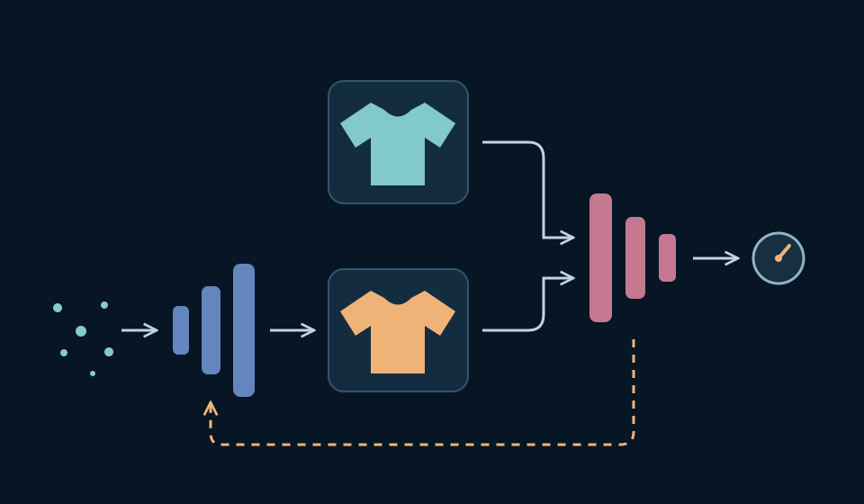{fig-alt="Conceptual illustration: random noise passes through a generator to a garment image. Real and generated garments enter the same discriminator; a dashed feedback path returns toward the generator. Schematic, not model outputs."}
:::
::::

::: {.notes}
This is the final lecture of the course; the following two weeks are student project presentations. Begin from what students already know: drawing a latent vector and decoding it can produce an image. Keep that generation path familiar and make the new training signal the question.

Ask: if a generated garment has no paired target image, who tells the generator what to improve? Let students suggest criteria before introducing the learned discriminator. Do not frame GANs as universally better than VAEs or imply that sharp-looking outputs establish diversity or generalization.

The thumbnail is an original course-made schematic inspired by the GAN training setup in Goodfellow et al., https://arxiv.org/abs/1406.2661. The upper garment represents observed data; the lower one represents a generated image. Both feed the same discriminator. The dashed return path previews training feedback through the discriminator, not a second image-generation path. It omits losses, targets, and alternating optimizer updates, which will be developed later. At generation time only the generator is needed. These drawn silhouettes are not experimental results.

The opening is approved. Section 1 now develops the need for learned feedback through actual images, a target-selection experiment, and a measured source classifier. Section 2 develops the two module contracts. Section 3 develops the learning objectives. Section 4 develops alternating updates. Section 5 builds and inspects a convolutional GAN. Section 6 evaluates the recorded model and concludes the lecture.
:::

## A first-level map of the lecture

:::: {.lecture-toc}
::: {.lecture-toc-item style="--toc-color:#2878c8"}
01

### From generating images to learning a judge
:::
::: {.lecture-toc-item style="--toc-color:#008e9b"}
02

### Two networks, two different jobs
:::
::: {.lecture-toc-item style="--toc-color:#ef5b45"}
03

### Turning competition into learning objectives
:::
::: {.lecture-toc-item style="--toc-color:#7655ad"}
04

### Training one network at a time
:::
::: {.lecture-toc-item style="--toc-color:#38865a"}
05

### Building an image GAN with convolutions
:::
::: {.lecture-toc-item style="--toc-color:#c94f78"}
06

### Judging samples, diversity, and failure
:::
::::

::: {.notes}
Keep the screen at this first level. Plan approximately 90 minutes and 20–30 substantive teaching slides, adjusting section lengths to the evidence rather than imposing a slide count. Use Fashion-MNIST as the continuous visual problem so setup does not obscure the new mechanism.

1. From generating images to learning a judge (about 10 minutes). Retrieve the prior-to-decoder sampling path briefly. Use real images and actual model outputs to ask what feedback a generator needs when no paired reconstruction target exists. Let students judge examples before proposing a learned discriminator.
2. Two networks, two different jobs (about 15 minutes). Compare the visible VAE training modules with the GAN modules before formalizing roles. Show random input → generator → image and real/generated image → shared discriminator. Connect the structure to a minimal PyTorch module contract. Distinguish training from generation; an unconditional GAN does not need an inference encoder.
3. Turning competition into learning objectives (about 15 minutes). Start with concrete discriminator scores and the direction each player wants them to move. Derive discriminator BCE and the practical non-saturating generator loss from those decisions. Distinguish that generator objective from the original minimax form; do not claim each minibatch solves the game or that a discriminator score is a universal realism metric. Primary source: Goodfellow et al., https://arxiv.org/abs/1406.2661.
4. Training one network at a time (about 20 minutes). Trace the two updates with a stateful graph and executable code. Show when fake images are detached, when the discriminator's parameters are frozen, and why generator training still requires derivatives through the discriminator. Include a short predict–pause–reveal gradient-path exercise. Use fixed latent draws across checkpoints so changing samples reveal training rather than changing noise.
5. Building an image GAN with convolutions (about 15 minutes). Compare the existing dense pair with a DCGAN-style convolutional pair; map changes in spatial shape to code. Reuse the course's compact architecture bars and familiar CNN operations, deriving any new upsampling operation before using it. Use recorded outputs from a documented run, with preprocessing and output range consistent. Source: Radford, Metz, and Chintala, https://arxiv.org/abs/1511.06434. Treat architecture guidelines as empirical design choices, not guarantees of stable training.
6. Judging samples, diversity, and failure (about 15 minutes). Inspect unfiltered fixed-seed galleries, repeated samples, and training trajectories. Let evidence expose mode collapse and instability; distinguish a limited gallery from a distribution-level evaluation. Do not use a loss curve alone as a quality ranking. Close by composing the taught data, generator, discriminator, losses, alternating updates, and evaluation into an image-generation task. A brief AE/VAE/GAN synthesis belongs here; leave substantial new model families out of the conclusion.

These are speaker planning notes for future sections. No empty section-divider slides are included in this opening draft.
:::

# 01 · From generating images to learning a judge {.section-slide .gan-section data-section-progress="1 / 6" data-background-color="#17212b"}

::: {.notes}
Allow about 10–12 minutes for this section: roughly 2 minutes for the source exercise, 3 for the target experiment, 3 for the measured classifier, and 2 for the transition. Students already know generation from a latent draw. Do not repeat the VAE derivation.

The four slides move from evidence to a problem with choosing feedback, then to a measured learned judge, and finally to the GAN idea. The only new trained component in the section's experiment is a binary classifier. The generator stays frozen throughout. Actual GAN training belongs to later sections.
:::

## Which images came from the dataset? {#gan-source-exercise}

Six garments: three dataset images and three outputs of our VAE. For each letter, predict the source and name one visual clue.



PAUSE<b>45 seconds</b><small>Commit to your guesses before the sources appear.</small>

WORKED SOLUTION · RECORDED PROVENANCE
<strong>Dataset: A, D, F.</strong> &nbsp; <strong>VAE outputs: B, C, E.</strong> Blur or texture may be clues here; the labels come from how the images were produced.

Actual <a href="https://arxiv.org/abs/1708.07747">Fashion-MNIST</a> images and frozen course VAE outputs · first three held-out examples per source, interleaved · illustrative gallery, not a quality benchmark.

::: {.notes}
Begin by asking students to look closely rather than defining adversarial learning. The task supplies the exact source balance; students predict the three dataset images and justify one choice with visible evidence. Give the full pause before advancing. On the next advancement, all six source labels and the worked solution appear together.

Do not announce that one family always looks blurry, or that a sharp boundary proves an image is real. In this small VAE's outputs, smooth texture is a useful clue; a future generator may remove that cue. The solution is established by provenance, not by a visual theorem. We did not choose examples according to classifier confidence or visual quality. Students' guesses on six known-balanced examples are an informal exercise, not a measured human benchmark.

All six images come from the section's held-out source-classification pool. A/D/F are the first three validation dataset images under split seed 41 (positions 12,000 onward in a permutation of Fashion-MNIST's training split). B/C/E are the first three independent standard-normal latent draws with seed 302 decoded by the existing lab's beta=1 VAE. We display decoder means, not sampled Bernoulli pixels. The saved generator was trained previously; no model changes during this exercise.

Ask after the reveal: could a network learn some of the distinctions you just used? Keep that question open until the classifier experiment; first establish what feedback an unconditional image generator lacks.
:::

## Which real image should this draw match? {#gan-target-experiment}

Keep the generated image fixed. Change only the proposed target.

Proposed target<button type="button" data-target="A" aria-pressed="true">A · T-shirt</button><button type="button" data-target="B" aria-pressed="false">B · Boot</button><button type="button" data-target="C" aria-pressed="false">C · Bag</button>

<figure><figcaption>One fixed VAE output</figcaption>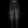<small id="gan-fixed-code">A fixed prior draw</small></figure>
<figure><figcaption id="gan-target-title">Proposed target A</figcaption>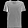<small>No pairing was supplied by the data.</small></figure>
<figure><figcaption>Absolute pixel difference</figcaption>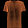<small>Same scale: black 0 → orange 1</small></figure>

Mean squared pixel error<strong id="gan-target-mse">—</strong>The output did not change.

::: {.fragment .takeaway}
The dataset gives us examples—not a target image for each random code.
:::

Course experiment · actual frozen VAE output and unrelated Fashion-MNIST validation images · pixel errors computed from the original floating-point tensors.

::: {.notes}
Retrieve only the part of autoencoder training that matters: when x is encoded, x is the reconstruction target. Now point to the generated image. It was decoded from a fresh normal draw; no input was encoded. There is no paired target x attached to that draw.

Ask students to nominate a target before using the three buttons. Each button changes the observed target, the difference heatmap, and measured mean squared pixel error. The generated output and its latent coordinates remain fixed. Choose A, B, then C and ask: did the generator improve when the displayed error decreased? No; only our chosen comparison changed.

The experiment does not claim that pixel error is meaningless, that generative learning without pairing is impossible, or that VAEs lack a valid objective. It shows why arbitrarily pairing each unconditional draw with one unrelated training image does not specify the desired task. Different legitimate garments can be far apart in pixels. Training against independent random targets with MSE tends toward an average; do not derive that result here or present the three displayed comparisons as its proof.

Reveal the takeaway only after students have interpreted the changing cost. We want the generated collection to resemble the data distribution. A learned discriminator is one way to obtain feedback about the difference; it is not the only possible distributional training method.

The candidate is the same output as B in the first exercise. Targets are the first validation example in each of three predefined classes, T-shirt, ankle boot, and bag. They were not selected to force an ordering of the MSE values. The heatmap is absolute difference with a common linear color scale; the scalar metric squares those differences before averaging over all 784 pixels. Minor visible quantization comes from PNG display; metrics use original tensors.
:::

## Can a network learn the distinction? {#gan-judge-experiment}

Same six images. Same frozen VAE. Only the classifier learns.

Classifier training<button type="button" data-epoch="0" aria-pressed="true">Before training</button><button type="button" data-epoch="1" aria-pressed="false">1 epoch</button><button type="button" data-epoch="4" aria-pressed="false">4 epochs</button><button type="button" data-epoch="8" aria-pressed="false">8 epochs</button>

Score for “dataset source”: <strong>0 = generated</strong> · <strong>1 = dataset</strong>



Held-out source accuracy<strong id="judge-accuracy">—</strong>

1,000 dataset images + 1,000 VAE outputs <small>Threshold 0.5 · balanced set · 50% chance baseline</small>

::: {.fragment .takeaway}
A learned distinction can supply feedback. Its score is not a universal realism rating.
:::

Measured course experiment · 784–128–64–1 classifier · 6,000 training examples per source · fixed generator, held-out images and latent draws · <a href="assets/evidence/section1/manifest.json">protocol and measurements</a>.

::: {.notes}
Start at “Before training.” Ask what students expect from a randomly initialized classifier. A score near 0.5 is not informed uncertainty; the model has not learned the distinction. The initial accuracy can equal the chance baseline by predicting the same class for nearly every image.

Click 1 epoch, then 4, then 8. The samples do not change. Each bar is an actual saved sigmoid output at that checkpoint. The large accuracy number is computed on all 2,000 held-out examples, not inferred from these six images. Ask students to compare their visual clues with what could be predictive for this source-classification problem. We have not inspected the classifier's features, so do not claim it definitely used blur, edges, or any particular visual cue.

This is a supervised binary classification experiment using a frozen VAE as the generated source. It is deliberately NOT an adversarially trained GAN. The source labels are available automatically: we know whether an example came from the dataset or generator. Garment-category labels are not the discriminator targets. The classifier's architecture is a familiar MLP with LeakyReLU hidden activations; it is not the convolutional model we will build later.

The generator is the previous homework's saved beta=1 VAE decoder, trained on 12,000 examples. The judge sees the first 6,000 of that training partition as its real training images and 6,000 fresh generated examples (noise seed 301). Its real validation images are at permutation positions 12,000–12,999, unseen during VAE or judge training. Its 1,000 generated validation images use a separate latent stream (seed 302). Judge initialization is seed 303, minibatch order seed 304, Adam at 0.001, batch 256, eight epochs. Rendering the website never trains this model.

Reveal the takeaway after inspecting the metrics. High discrimination accuracy means the current sources are distinguishable under this experiment. It is not evidence of a good generator, a calibrated probability of realism, or performance against another generator. The scores do not establish semantic understanding. This changing learned decision function is the ingredient we will connect to a trainable image maker.
:::

## Could the judge teach the image maker? {#gan-feedback-idea}

We have learned to distinguish sources. Now give the image maker a reason to change.

<svg viewBox="0 0 1280 485" role="img" aria-labelledby="gan-flow-title gan-flow-desc">
<title id="gan-flow-title">The proposed adversarial feedback loop</title><desc id="gan-flow-desc">Real examples and generated images reach the same learned judge. On advancement, a dashed training-feedback path appears from the judge toward the generator. This is a conceptual GAN setup, not measured GAN training.</desc>
<defs><marker id="gan-flow-arrow" viewBox="0 0 10 10" refX="9" refY="5" markerWidth="6" markerHeight="6" orient="auto"><path d="M1 1 9 5 1 9" fill="none" stroke="#526575" stroke-width="1.5"/></marker><marker id="gan-feedback-arrow" viewBox="0 0 10 10" refX="9" refY="5" markerWidth="6" markerHeight="6" orient="auto"><path d="M1 1 9 5 1 9" fill="none" stroke="#ef5b45" stroke-width="1.5"/></marker></defs>
<g font-family="Manrope,sans-serif" fill="#17212b">
<text x="45" y="104" font-size="26">Dataset</text>
<image href="assets/evidence/section1/gallery-0.png" x="630" y="30" width="142" height="142"/>
<text x="701" y="205" text-anchor="middle" font-size="23">Real image</text>
<text x="45" y="302" font-size="26">Random z</text>
<rect x="246" y="247" width="240" height="104" rx="16" fill="#dceeff" stroke="#9ebdd1" stroke-width="2"/>
<text x="366" y="289" text-anchor="middle" font-size="28" font-weight="700">Image maker</text><text x="366" y="325" text-anchor="middle" font-size="22">Generator</text>
<image href="assets/evidence/section1/candidate.png" x="630" y="233" width="142" height="142"/>
<text x="701" y="406" text-anchor="middle" font-size="23">Generated image</text>
<rect x="960" y="155" width="275" height="118" rx="16" fill="#f6e1d9" stroke="#d7aea0" stroke-width="2"/>
<text x="1097" y="202" text-anchor="middle" font-size="28" font-weight="700">Learned judge</text><text x="1097" y="241" text-anchor="middle" font-size="22">Discriminator</text>
<g fill="none" stroke="#526575" stroke-width="3" marker-end="url(#gan-flow-arrow)"><path d="M181 100H612"/><path d="M181 298H228"/><path d="M504 298H612"/><path d="M790 100H882Q901 100 901 120V185H942"/><path d="M790 304H882Q901 304 901 284V244H942"/></g>
<g class="fragment" data-fragment-index="0"><path d="M1096 293V434Q1096 452 1078 452H384Q366 452 366 434V369" fill="none" stroke="#ef5b45" stroke-width="4" stroke-dasharray="11 8" marker-end="url(#gan-feedback-arrow)"/><rect x="449" y="427" width="490" height="46" fill="#f5f1e8"/><text x="694" y="457" text-anchor="middle" font-size="24" fill="#c44834">Training feedback to the generator</text></g>
</g></svg>

::: {.fragment .takeaway data-fragment-index="0"}
The discriminator learns to separate. The generator learns to challenge it.
:::

Schematic GAN training idea, not a measured adversarial run · image tiles reuse the earlier experiment · course diagram based on <a href="https://arxiv.org/abs/1406.2661">Goodfellow et al., 2014</a>.

::: {.notes}
Before revealing the dashed path, ask: which model did we improve in the previous experiment? Only the judge. The generated images stayed exactly the same. What additional change would make this a generative learning procedure?

Advance once to reveal the training-feedback path and conclusion together. The discriminator is trained to distinguish observed examples from generated ones. The generator is trained using feedback through that discriminator to make its outputs harder to distinguish from data. This introduces the idea; the next section will compare module structures, separate the two roles, and map them to code.

The arrow represents a training signal implemented through a differentiable objective and derivatives through the discriminator; it is not a request to copy a real image and does not mean a binary label alone tells us how to edit every pixel. During a generator update, gradients pass through the discriminator to the generator; later we will distinguish that gradient path from updating discriminator parameters. Do not explain detach/freeze syntax here.

The diagram is explicitly schematic. It reuses the previous actual images as visual tokens, but no GAN generator has been trained for this section and this slide claims no improvement. In a full GAN both networks change over training, so the judge is a moving source of feedback. Later sections will examine instability and missing diversity instead of treating competition as a guarantee of success. At generation time the generator alone maps a fresh latent draw to an image.

This setup follows Goodfellow et al., Generative Adversarial Nets (2014). The familiar VAE decoder in the preliminary experiment was a way to obtain a fixed generated source, not a requirement that GANs use a VAE or its encoder. Close with the question for section 2: what does each network receive, produce, and learn?
:::

# Two networks, two different jobs {.gan-section .gan-section-two background-color="#17212b" data-section-progress="02 / 06"}

::: {.notes}
Budget about 15 minutes for this section, including the tensor exercise. Carry the visual identities forward: blue is the generator, peach is the discriminator. The objective is to understand the two module contracts before introducing their losses and alternating updates.
:::

## Keep the sampler. Change the training system. {#gan-architecture .gan-s2}



::: {.fragment .takeaway data-fragment-index="0"}
An unconditional GAN needs no encoder: random code → image → learned judge.
:::

Course-made structural comparison · schematic paths, not trained GAN results · <a href="https://arxiv.org/abs/1312.6114">Kingma &amp; Welling, 2013</a>; <a href="https://arxiv.org/abs/1406.2661">Goodfellow et al., 2014</a>.

::: {.notes}
Start with the VAE row. Retrieve the familiar path briefly: an observed image determines a distribution over latent codes; a sampled code goes through the decoder; the reconstruction is compared with the same input. The diagram abbreviates the VAE training system and omits the KL regularizer. The reconstruction symbol is schematic, not an empirical reconstruction. Ask which module actually makes pixels.

Reveal the GAN row. The decoder-like mapping survives as the generator's role, but this does not mean reusing the VAE weights. We will instantiate a fresh network. The unconditional generator starts from a random code; it does not need an input-image encoder or a paired reconstruction target. Real and generated images meet the SAME discriminator. The dataset image is an actual Fashion-MNIST example; the generated-image symbol makes no claim about trained quality.

The key structural change is the additional learned discriminator supplying a training criterion. Do not present the discriminator as a replacement encoder: its output is a source-classification logit, not a latent representation used to reconstruct the image. An encoder can be added to other adversarial formulations, but it is not required in this basic unconditional GAN.

Trace the familiar sampling path in blue. At generation time only random z and G remain. Keep optimization and losses for the next sections. The two roles do not require two particular architecture families: both can be MLPs initially, then convolutional networks later.
:::

## Trace one batch through the two networks {#gan-routing-exercise .gan-s2}

Given: <strong>4 codes of length 16</strong>; grayscale images are <strong>28 × 28</strong>. Find both output shapes. Which modules are needed only to generate?



PAUSE<b>60 seconds</b><small>Keep the batch axis. Count outputs for one image first.</small>

::: {.exercise-solution .fragment .gan-routing-solution data-fragment-index="0"}
WORKED SOLUTION

G: 4 × 1 × 28 × 28 pixels. D: 4 × 1 logits. Generation uses G alone.

<button type="button" data-route="real" aria-pressed="false">Score real</button><button type="button" data-route="fake" aria-pressed="false">Score generated</button><button type="button" data-route="sample" aria-pressed="false">Generate only</button>

Trace a path: the same D accepts either image source.

:::

Batch-first PyTorch shapes · one source logit per image, not ten garment-class scores · <a href="assets/gan_modules.py">executable module checks</a>.

::: {.notes}
Let students solve before revealing either output shape. State that D produces one raw binary source-classification logit for each image. The task is to account for axes, not to guess an architecture. The leading 4 is the batch dimension; 1 is grayscale; 28 by 28 are spatial dimensions. Four images produce four logits, not one judgment for the entire batch.

Advance once: both missing shape labels and the worked solution appear. The pause panel is replaced by the solution in the same space. Use the buttons to trace three forward paths. Score real: the dataset batch goes straight to D. Score generated: z goes through G, then its image batch goes through D. Generate only: z goes through G and stops at the images. Dimmed modules are unused in that forward path; this is not a statement about freezing parameters or gradient tracking during training.

Ask: does the generator consume a real garment here? No. Does changing image source instantiate a second discriminator? No. The two calls use the same object and weights. The controls highlight a schematic; the shapes are verified by actual forward passes in the linked source. No inference or training is run by the buttons. If students ask about optimization, distinguish forward routing from parameter updates and defer the latter to section 4.

Reset all routes when returning to the unrevealed exercise so the answer remains hidden. The code examples use latent dimension 16 for a small demonstrator; this is a design choice, not a GAN requirement.
:::

## G turns a code into an image tensor {#gan-generator-code .gan-s2}





::: {.fragment .takeaway data-fragment-index="0"}
784 outputs become 1 × 28 × 28 pixels. Sigmoid matches real images scaled to [0, 1].
:::

Actual first output of this randomly initialized G · no training · <a href="assets/gan_modules.py">runnable source</a> and <a href="assets/evidence/section2/contracts.json">measured checks</a> · real data: <a href="https://github.com/zalandoresearch/fashion-mnist">Fashion-MNIST</a>.

::: {.notes}
Walk from the diagram to matching code. Each row of z has 16 independent standard-normal coordinates. Linear layers transform the last dimension while preserving the batch axis. The output layer has 784 scalar activations, and Unflatten reshapes dimension 1 into channel, height, and width. The image tensor remains differentiable; reshaping does not generate new pixels.

Ask what pixel range the final activation imposes, then reveal the forward call and measured shape. The provided real-image pipeline converts uint8 intensities to floating-point values divided by 255, so the two sources use the same [0,1] convention. An alternative tanh output would require matching the real-image scale to [-1,1]; avoid making a preprocessing difference an easy source clue.

The gray texture is the first actual output of this initialized generator for the seeded batch, not a trained GAN result. This demonstrates a correct programming contract, not successful generative learning. It is expected to look unstructured: no objective or optimization has been supplied. The locally recorded output makes the code-to-image mapping inspectable without running a model in the browser.

The checked executable source confirms the exact shapes for batch sizes 1, 4, and 7, finite outputs, the [0,1] range, and repeatability for the same code with fixed weights. Different random codes change outputs. The later convolutional architecture will improve the image-specific inductive bias; these MLP widths are simply an accessible reference implementation.
:::

## D returns one logit for each image {#gan-discriminator-code .gan-s2}





::: {.fragment .takeaway data-fragment-index="0"}
One D, two image sources. Its raw output is a logit; sigmoid converts it to a score.
:::

Actual real image and untrained G output · independently initialized G and D · <a href="assets/gan_modules.py">executable source</a> · logits follow the <a href="https://docs.pytorch.org/docs/stable/generated/torch.nn.BCEWithLogitsLoss.html">PyTorch binary-loss contract</a>.

::: {.notes}
Map the merge in the diagram to the two calls to D. Both batches have the same shape and intensity convention. Flatten preserves the batch axis and gives 784 features per image. The last linear layer emits one number per row, so both calls return (4,1). G and D own separate parameter sets, but there is only one D shared across real and generated inputs.

Reveal the forward calls. Here real is the supplied batch of dataset images from the exercise; fake is the output of the previous slide. These are contiguous excerpts from the runnable reference file. The printed shape belongs to fake_logits. Applying sigmoid afterward is optional for displaying the source score; it is not a layer inside this D. In the next section the numerically stable binary loss will consume logits directly, so we must not apply sigmoid twice.

A raw logit can be any real number: zero maps to 0.5, positive values to scores above 0.5, and negative values to scores below 0.5. Once targets are specified, a larger logit will favor the dataset-source label. At initialization that number has no learned realism interpretation. This network is not predicting garment categories; class labels are unused.

The executable check verifies both calls individually and verifies that evaluating the concatenated batch produces the same values, with unchanged D parameters. This simple MLP has no batch-dependent or stochastic layers. Do not generalize that numerical equivalence to every possible architecture in training mode. End by asking: what should each network try to change? That motivates section 3's different objectives.
:::

# Turning competition into learning objectives {.gan-section .gan-section-three background-color="#17212b" data-section-progress="03 / 06"}

::: {.notes}
Allow about 18 minutes. Students already know binary classification, logits, and backpropagation. Retrieve binary cross-entropy through one pair of predictions, then expose the conflicting objectives on one generated example. The gradient comparison explains the generator loss we will implement. Parameter updates and detach/freeze belong to section 4.
:::

## What should a correct judge be rewarded for? {#gan-discriminator-loss .gan-s3}

Two illustrative predictions. Which source target belongs to each image?



LD = meanreal[−ln p(x)] + meanz[−ln(1 − p(G(z)))]

::: {.fragment .takeaway data-fragment-index="1"}
For this pair: LD = 0.223 + 0.223 = 0.446. Minimize it by raising real scores and lowering fake scores.
:::

p(u) = sigmoid(D(u)); D returns logits in our code · natural logarithms · sum of two source means, without a ½ factor · course example based on <a href="https://arxiv.org/abs/1406.2661">Goodfellow et al., 2014, §3</a>.

::: {.notes}
Begin with the two score predictions, explicitly invented for easy arithmetic. These are not predictions attached to a displayed model output. Ask which target follows from provenance. Reveal both targets, per-example costs, and the batch expression together. A real sample has source target 1; a generated sample has source target 0. No human realism rating or garment-category annotation is needed.

We distinguish the code API from the paper's notation: our D emits a logit a, and p(u)=sigmoid(D(u)) denotes its source score. Binary cross-entropy is −y ln p −(1−y) ln(1−p). For target 1 only −ln p remains; for target 0 only −ln(1−p) remains. The two 0.8 probabilities of the correct source give equal costs. Reveal the total after students have evaluated the terms. All logs are natural.

For a batch, average over real examples and independently average over latent draws, then add the means. This matches the two expectations in the original discriminator objective after changing its sign for minimization. We choose this convention consistently in code. Averaging the two means instead would halve the loss and gradients; it preserves minimizers but changes gradient scale. Do not silently switch conventions when reporting values.

The generator outputs are considered fixed for this discriminator objective. Minimizing this loss changes the judge so real logits increase and fake logits decrease. That statement is a desired direction at individual outputs, not a guarantee that a shared network can improve every example simultaneously. The familiar supervised loss supplies D's objective; the next slide asks why G must not minimize that same source-classification loss.
:::

## One generated image. Opposite desired scores. {#gan-opposing-losses .gan-s3}

Hold the image source fixed: <strong>generated</strong>. Move its hypothetical judge score.

<label for="gan-fake-score">p(G(z))</label><input id="gan-fake-score" type="range" min="1" max="99" value="20" step="1" aria-label="Hypothetical discriminator score on a generated image"><output id="gan-fake-score-value" for="gan-fake-score">0.20</output>

0 · classified as generated1 · classified as dataset

<h3>D's objective on this image</h3>
Target 0 · push p down ←

−ln(1 − p)
<output id="gan-d-fake-loss">0.223</output>
<i id="gan-d-loss-bar"></i>

<h3>G's objective on this image</h3>
Target 1 · push p up →

−ln p
<output id="gan-g-fake-loss">1.609</output>
<i id="gan-g-loss-bar"></i>

LG = meanz[−ln p(G(z))] non-saturating generator loss

::: {.fragment .takeaway data-fragment-index="1"}
Target 1 expresses what G wants D to predict. The image is still generated.
:::

Exact loss arithmetic for a hypothetical score; the slider does not train or alter an image · both loss bars use a common 0–4.61 scale · <a href="https://arxiv.org/abs/1406.2661">Goodfellow et al., 2014, §3</a>.

::: {.notes}
Start with only D's side visible. Move from 0.20 to 0.80: its fake-example cost rises from 0.223 to 1.609. Ask what would happen if the generator minimized this same target-zero cost: it would favor being identified as generated. Reveal G's target-one loss and the mean-over-codes expression. Now repeat the movement: G's cost falls from 1.609 to 0.223 while D's fake-example cost rises. Show 0.50, where both per-example costs are ln 2, about 0.693. Equal costs at this hypothetical score do not certify a good generator.

The slider is a scalar thought experiment. It changes a hypothetical p while holding source identity fixed; it is not an optimizer step or a measured change in an image. Bars use the same scale across both objectives, with a maximum of −ln(0.01), and outputs update immediately. It avoids comparing disconnected numerical scales.

Target 1 in the generator objective means “make D classify this generated sample as coming from the dataset.” It does not relabel the sample as real for D's own training. During the G objective D supplies a differentiable function, and the adjustable parameters are G's. D's real-image term has no dependence on G and is unnecessary here. Later we will make parameter ownership explicit in code.

This is the non-saturating objective used in our implementation. It is not simply the negative of the entire discriminator loss. The original minimax generator minimizes mean ln(1−p); it also favors increasing p, but has different gradient behavior. The next slide gives the reason for choosing −ln p instead. Neither this target choice nor a low generator loss is by itself an evaluation of coverage, diversity, or sample quality.
:::

## Rejected samples still need a useful gradient {#gan-gradient-loss .gan-s3}



<strong>Original minimax</strong> ℓ = ln(1 − p) ∂ℓ/∂a = −p

<strong>Non-saturating</strong> ℓ = −ln p ∂ℓ/∂a = p − 1

a = D(G(z)); p = sigmoid(a)

Inspect p<button type="button" data-gradient-p="0.01" aria-pressed="true">0.01 · rejected</button><button type="button" data-gradient-p="0.20" aria-pressed="false">0.20</button><button type="button" data-gradient-p="0.80" aria-pressed="false">0.80</button><strong id="gan-gradient-values">|∂ℓ/∂a|: 0.01 vs 0.99</strong>

::: {.fragment .takeaway data-fragment-index="0"}
At p = 0.01, non-saturating gives 99× the gradient magnitude at the logit. Both losses push it upward.
:::

Analytic curves; selected points verified with <a href="assets/evidence/section3/loss-checks.json">PyTorch autograd</a> · logit gradients, not full parameter-gradient norms · course figure based on <a href="https://arxiv.org/abs/1406.2661">Goodfellow et al., 2014, §3</a>.

::: {.notes}
Begin at p=0.01, a≈−4.595. This is a confidently rejected generated sample. The vertical dashed line selects its logit on the shared horizontal axis. The red original-minimax curve is nearly zero; the blue non-saturating curve is nearly one. Ask which supplies the stronger local signal, then reveal the numerical ratio and shared direction. This claim concerns gradient magnitude at the discriminator logit, not an observed training-speed improvement.

Derive only as much as students need: dp/da=p(1−p). For ln(1−p), the chain rule gives −p. For −ln p, it gives −(1−p)=p−1. Both derivatives are negative, so descent favors increasing a. The old minimax generator cost can be negative; loss positivity is not required. Inspect p=0.20 and 0.80 to see that non-saturating is not larger everywhere. It specifically avoids the small sigmoid-related gradient when D confidently rejects a generated sample.

The full generator gradient also multiplies the derivative of the discriminator logit with respect to its input and the derivative of G with respect to its parameters. A stronger scalar derivative does not guarantee useful image directions, eliminate vanishing derivatives elsewhere, ensure convergence, or solve mode collapse. At fixed G, D, and one sample these scalar factors multiply the same remaining chain, but aggregate minibatch gradient norms need not obey this simple ratio.

These are exact analytic functions, not empirical training trajectories. The local builder independently differentiates both losses with PyTorch float64 at p=0.01, 0.20, 0.50, 0.80, and 0.99 and checks the formulas to numerical precision. The 2014 paper explicitly motivates the non-saturating alternative for stronger early gradients. Our loss code next implements that choice.
:::

## Three targets. Which ones belong in the code? {#gan-loss-code-exercise .gan-s3}

Given: real_logits and fake_logits both have shape <strong>(4, 1)</strong>. Fill each “?” with a tensor of zeros or ones. Use the non-saturating G loss.

<strong>Real → D</strong> Identify the dataset source.

<strong>Generated → D</strong> Identify the generated source.

<strong>Generated → G objective</strong> Make D favor the dataset source.



PAUSE<b>60 seconds</b><small>Match target shape and dtype to the logits. Do not apply sigmoid first.</small>

WORKED SOLUTION · 1, 0, 1
On section 2's recorded logits: LD = <strong>1.4044</strong>; LG = <strong>0.7014</strong>.

Loss arithmetic only; separate forward passes and optimizer updates follow in section 4 · measured on untrained section 2 outputs · <a href="assets/build_section3.py">executable checks</a> · <a href="https://docs.pytorch.org/docs/stable/generated/torch.nn.BCEWithLogitsLoss.html">PyTorch BCEWithLogitsLoss</a>.

::: {.notes}
Let students choose 1,0,1 before advancing. The task provides the logits; it is not a complete training loop. The first two targets supervise D using provenance, while the final target implements G's desired prediction. Advance once to replace all three question marks with the exact code and reveal the measured losses. All targets use ones_like or zeros_like so shape, floating dtype, and device match the logits.

BCEWithLogitsLoss combines the sigmoid and binary cross-entropy in a numerically stable operation. Passing an already sigmoid-transformed score would apply the transformation again and change the objective. Default reduction is mean: each call averages its four examples, and the two discriminator means are added. The generator averages its four target-one terms. These measured values use the unchanged logits saved in section 2, not the earlier invented 0.8/0.2 pair.

The reference script executes precisely this loss arithmetic, checks agreement with direct probability formulas at moderate logits, and separately checks the logit derivatives in float64. It does not train a GAN. In an actual training loop, use appropriate fresh forward passes and parameter ownership for each loss; do not call backward on these two losses as if a shared cached graph were a complete update recipe. Section 4 will show that recipe, including detach and how gradients can pass through a frozen discriminator into G.

End with the unresolved implementation question: if each loss goes through D, how do we change only the network whose turn it is? Students now have the two objectives; the next section will make the update paths visible.
:::

# Training one network at a time {.gan-section .gan-section-four background-color="#17212b" data-section-progress="04 / 06"}

::: {.notes}
About 15 minutes. Follow one alternating update through its graph, exact executable code, and a debugging exercise. The new distinction is between a network whose parameters are fixed and an operation whose input derivative must still be computed.
:::

## Same networks. Different update paths. {#gan-alternating-paths .gan-s4}

One iteration<button type="button" data-update-turn="D" aria-pressed="true">1 · D's turn</button><button type="button" data-update-turn="G" aria-pressed="false">2 · G's turn</button>



D's turn: classify both sources. Stop the generated-image path before G.

::: {.fragment .takeaway data-fragment-index="0"}
A fixed network can still transmit gradients to its input.
:::

Schematic forward and backward paths; red arrows represent derivatives, not image flow · one D step then one G step in our example · <a href="https://arxiv.org/abs/1406.2661">Goodfellow et al., 2014, Algorithm 1</a>.

::: {.notes}
Begin with D's turn. The gray arrows carry values toward the loss; red arrows represent backward differentiation. The real branch and the generated branch feed the same D. A detach boundary makes the generated image a fixed input for this loss. D's optimizer steps, and G's parameters remain unchanged.

Switch to G's turn. The real branch disappears because this loss depends only on generated examples. The forward path through D remains, and the red derivative path continues all the way into G. D's parameters are held fixed, but its response to changes in its input is still needed. Reveal the takeaway after tracing that distinction. Toggle the two turns once more, asking students to predict which parameter set changes each time.

The buttons switch a schematic, not training. The next slides show a measured one-iteration audit using the exact MLPs from section 2. One D step followed by one G step is the chosen teaching schedule; update ratios can vary. Each optimizer owns only its network's parameters and maintains independent state. Backward computes derivatives; optimizer.step changes the parameters owned by that optimizer. Computing a gradient does not itself update a weight.

We will recompute G(z) and D outputs in the G turn after the D update, avoiding a stale forward graph. The same z may be reused for this illustration; a new draw is also possible. Do not imply that alternating updates guarantee convergence.
:::

## D's turn: treat generated images as fixed inputs {#gan-d-update .gan-s4}





::: {.fragment .takeaway data-fragment-index="0"}
.detach() cuts this route into G. opt_D.step() updates only D's parameters.
:::

Executed on four Fashion-MNIST training examples and four generated outputs · Adam, lr = 0.001 · <a href="assets/build_section4.py">runnable update audit</a> · <a href="assets/evidence/section4/update-checks.json">recorded parameter checks</a>.

::: {.notes}
The setup is the section 2 MLPs, BCEWithLogitsLoss, and two independent Adam optimizers: opt_D=Adam(D.parameters(), lr=0.001) and opt_G=Adam(G.parameters(), lr=0.001). real is a (4,1,28,28) floating tensor scaled to [0,1]; z is (4,16). The linked runnable script includes all initialization. This is a single audited iteration, not a quality experiment or recommended learning-rate sweep.

Read the forward computation first. Ensure D parameters require gradients, clear its previous gradients, compute fake, and pass fake.detach() into D. Detach does not change pixel values or copy a different generated image; it returns a tensor disconnected from G's graph. We do not modify it in place. The real and fake target choices match section 3.

Before advancing, ask which parameters will change. Reveal backward and the optimizer step with the takeaway. The measured audit compares parameter tensors bit for bit: all six D tensors change, and all six G tensors remain unchanged. Each model has three linear layers, each with a weight and bias, hence six tensors rather than six scalar parameters. With cleared initial gradients, no G gradients are produced in this turn.

Computing G under no_grad would also avoid building its graph for D's turn. Detach is shown to make the boundary visible. It is the optimizer ownership that determines which parameters are stepped; detach additionally prevents unnecessary gradients into G. It does not clear stale G gradients left by previous turns, so the G turn explicitly clears its own gradients before backward.
:::

## G's turn: pass through D without updating D {#gan-g-update .gan-s4}





::: {.fragment .takeaway data-fragment-index="0"}
Freeze D's parameters, keep its input derivative, and step G's optimizer.
:::

Same audited iteration, after the D step · fresh forward computation through the updated D · <a href="assets/evidence/section4/update-checks.json">G: 6/6 tensors changed; D: 0/6</a> · <a href="https://docs.pytorch.org/docs/stable/notes/autograd.html">PyTorch autograd mechanics</a>.

::: {.notes}
Read requires_grad_(False) as “do not accumulate gradients for D's parameters,” not “disable differentiation through D.” fake still requires gradients because it was computed by G. Autograd must therefore record the D operations necessary to differentiate the output with respect to fake, and then back into G.

Clear G's previous gradients and recompute fake=G(z). Compute fresh discriminator logits after the preceding D optimizer step. Do not reuse cached fake_logits from the D turn: those used detached images and the earlier D parameters. Use the target-one objective, then reveal backward, opt_G.step, and restoration of D's requires_grad flag. Only G's optimizer is stepped. All six G parameter tensors change in the audit; D's tensors remain bit-for-bit identical during this turn.

The audit clears D's old gradients separately before measuring new gradient production, because freezing parameters does not erase stored .grad fields. That audit-only clearing is not needed for the displayed update's correctness; the next D turn clears D gradients before its backward. No retain_graph=True is needed because these are fresh forward computations.

This reference D is an MLP without BatchNorm or dropout. Freezing parameters is not the same as calling eval(), and it does not freeze mutable running statistics in architectures that have them. The next architecture section will need an explicit policy for such layers. no_grad around D is not a substitute here: it would remove the path to G. The next exercise exposes that bug with measured evidence.
:::

## “Freeze D” — did we cut too much? {#gan-update-debug .gan-s4}

Given: it is G's turn; G is trainable and its old gradients are cleared. Predict what happens at backward. Repair the highlighted block.

PYTORCH · DIAGNOSE THE G TURN<strong>one misplaced context</strong>
<pre><code>fake = G(z)
with torch.no_grad():
    fake_logits = D(fake)
loss_G = bce(fake_logits, torch.ones_like(fake_logits))
loss_G.backward()</code></pre>

PAUSE<b>60 seconds</b><small>Does the loss still have a differentiable path to G?</small>

WORKED SOLUTION · VERIFIED IN PYTORCH
<strong>loss_G.requires_grad is False.</strong> backward raises an error; G receives no gradients.
<pre><code>D.requires_grad_(False)
fake_logits = D(fake)  # ordinary grad mode</code></pre>
After G's step, restore <code>D.requires_grad_(True)</code>.

Actual failing execution captured in the <a href="assets/evidence/section4/update-checks.json">update audit</a> · original course debugging example · <a href="https://docs.pytorch.org/docs/stable/notes/autograd.html#locally-disabling-gradient-computation">PyTorch: locally disabling gradient computation</a>.

::: {.notes}
Students should predict an error, not merely “the generator will learn slowly.” With this code the fake logits were computed in no_grad mode. Since the targets do not require gradients either, the loss has requires_grad=False and no grad_fn. Calling backward therefore raises RuntimeError. The runnable audit executes this exact failure, captures the error, and verifies that G's gradients remain absent after its previous gradients have been cleared.

Reveal the diagnosis and repair together. Replace the no_grad context with D.requires_grad_(False) and call D in ordinary gradient mode. Keep the forward path from fake to the loss. Restore D's parameter flags after stepping G. This changes which leaf parameters receive gradients while preserving differentiation with respect to the input.

Using fake.detach() in this generator turn would also cut the required path. If D remained trainable, such a bug could still yield a valid loss and D gradients, while G receives none, making it less obvious than this example. Ask that as an oral transfer question only after the main repair is understood.

Conclude with three distinct responsibilities: choose the loss target, preserve or cut the correct gradient path, and step only the intended optimizer. We now have a functioning alternating MLP update. Section 5 will replace its image-processing modules with convolutional structure without changing those responsibilities.
:::

# Building an image GAN with convolutions {.gan-section .gan-section-five background-color="#17212b" data-section-progress="05 / 06"}

::: {.notes}
Allow about 15 minutes. Retrieve convolution briefly; the new mechanism is learned spatial expansion. Compare structure first, expose weighted overlap, then trace exact layers and inspect locally recorded outputs. This is a small DCGAN-inspired adaptation for 28×28 grayscale images, not a reproduction of the original paper.
:::

## Give the generator a spatial structure {#gan-conv-architecture .gan-s5}



::: {.fragment .takeaway data-fragment-index="0"}
G grows feature maps into pixels; D compresses pixels into one logit. The two losses and alternating updates stay the same.
:::

Course-made architecture comparison · shapes omit the batch axis · ConvT = transposed convolution · small 28×28 adaptation inspired by <a href="https://arxiv.org/abs/1511.06434">Radford, Metz &amp; Chintala, 2015</a>.

::: {.notes}
Start with the dense generator students have just executed. Every hidden representation is a vector; the final 784 values acquire their image arrangement at reshape. Reveal the convolutional alternative. The latent coordinates are reshaped to 16 channels at one spatial location, not a 4×4 image. A learned 7×7 transposed convolution creates 64 feature maps at 7×7. Two learned stride-two expansions produce 14×14 and 28×28.

The blue bars are spatial transformations; green bars are normalization and activation within a hidden stage; the purple final activation controls image range. Channels decrease while spatial resolution increases in this small generator. A discriminator follows the opposite spatial direction with ordinary strided convolutions. It is not a tied-weight inverse of G. Convolutions impose local connectivity and shared spatial weights; they do not guarantee good samples or establish superiority over the MLP without a controlled comparison.

The original DCGAN work motivates using strided convolutions, learned upsampling, normalization, and appropriate activations. Our compact 28×28 variant changes channel widths and omits discriminator BatchNorm to keep parameter-freezing behavior explicit. G uses BatchNorm and ReLU internally, then Tanh; D uses LeakyReLU and returns logits. These are architecture choices, not a new adversarial objective. The next slide isolates what a transposed convolution actually computes.
:::

## G builds an image. D reduces it to a logit. {#gan-spatial-architecture .gan-s5}



Dimensions: <strong>channels × height × width</strong> · ConvT = transposed convolution · depth suggests channels.

Original course schematic of the exact section 5 models; block sizes are illustrative, not to scale · image: actual epoch-60 output, draw 1 · G and D have independent weights · <a href="https://arxiv.org/abs/1511.06434">DCGAN architecture context: Radford et al., 2015</a>.

::: {.notes}
This is the spatial overview to keep in mind throughout the section. Start with G alone. The tiny face at the left represents 16 latent channels at a single spatial location; it is not a small observed image. Follow the growing faces: 1×1 becomes 7×7, then 14×14, then 28×28. Stack depth suggests the number of channels, while labels give exact values. The 64-channel feature map is spatially smaller but deeper than the 32-channel map. These intermediate grids are schematic features, not measured activations.

The first operation projects the latent code spatially with a 7×7 transposed convolution. The next two use kernel 4, stride 2, padding 1. Hidden stages use BatchNorm and ReLU, and the image stage uses Tanh. The image is an actual recorded sample from our model, not an invented illustration. Transposed convolution is sometimes called deconvolution in architecture figures; it is a learned expansion, not an inverse reconstruction operation.

Advance once to reveal D. Its input can be a real dataset image or a generated image; this schematic uses the same generated sample as a visual token to connect the two rows. D's faces shrink from 28×28 to 14×14 to 7×7 to 1×1. Channels increase from 1 to 32 to 64 before the final convolution combines all features into one channel at one position. Flatten then yields one raw logit per example, with batch shape (B,1); no final sigmoid is used because the loss consumes logits.

Both paths run left to right. G and D have independently learned weights; the opposing geometry does not make them mathematical inverses. Face sizes and depth are schematic so small stages remain readable; the printed dimensions are authoritative. This overview supplements the compact layer bars and code views, exposing the spatial geometry that their lists of shapes can obscure. The next slide explains the weighted-overlap mechanism behind expansion.
:::

## Enlarge by placing and adding learned patterns {#gan-transpose-mechanism .gan-s5}

One channel in 1D: input <strong>[1, 2]</strong>, kernel <strong>[1, 2, 1]</strong>, stride <strong>2</strong>, no padding. The second input places its weighted kernel two positions to the right.



Output length = (input length − 1) × stride − 2 × padding + kernel size

(2 − 1) × 2 + 3 = 5 positions

::: {.fragment .takeaway data-fragment-index="1"}
For our 2D layer: (7 − 1) × 2 − 2 × 1 + 4 = 14, along both height and width.
:::

Exact toy computation verified with PyTorch · dilation 1, output_padding 0, no bias in the toy · transposed convolution applies a learned linear map, not an inverse convolution · <a href="https://docs.pytorch.org/docs/stable/generated/torch.nn.ConvTranspose2d.html">official API and output-size rule</a>.

::: {.notes}
Read the first contribution as input value 1 multiplied by the entire kernel, placed at positions 0,1,2. The second contribution is value 2 times the same kernel, placed at positions 2,3,4 because stride is 2. Dots mean no contribution. Ask what happens at the highlighted overlap before revealing the sum. The result is [1,2,3,4,2]. This exact computation is checked with ConvTranspose1d in the training script; the kernel is chosen for arithmetic clarity, not learned in this toy.

The output support runs from the first kernel's beginning to the final kernel's end, explaining (n−1)s+k with no padding. The displayed rule includes symmetric padding under dilation 1 and output_padding 0. Reveal the numerical application to the generator's second layer: 7 becomes 14 with kernel 4, stride 2, padding 1. In 2D, each input activation places a weighted kernel patch, contributions overlap and add across spatial positions and input channels, and each output channel has learned weights.

The operation is the transpose of the linear convolution operator for the matching geometry, not an inverse that recovers lost image information. There is no encoder output to invert in this unconditional generator. The weights are learned by the generator objective. Increasing resolution alone does not invent meaningful structure; that structure must be learned. Kernel/stride choices also affect overlap patterns. Detailed artifact evaluation belongs in the last section.
:::

## Trace each spatial stage into its layer {#gan-conv-code .gan-s5}

Inspect<button type="button" data-conv-module="G" aria-pressed="true">Generator G</button><button type="button" data-conv-module="D" aria-pressed="false">Discriminator D</button>









::: {.fragment .takeaway data-fragment-index="0"}
Tanh outputs [−1, 1]: scale real pixels to the same range. D still returns raw logits.
:::

Exact modules used in the recorded run · <a href="assets/conv_gan.py">runnable source</a> · G BatchNorm: train mode on G turns, eval mode on D turns and snapshots; D has no BatchNorm · <a href="https://arxiv.org/abs/1511.06434">DCGAN-inspired adaptation</a>.

::: {.notes}
Trace the G bars into the code line by line. ConvTranspose2d arguments here are input channels, output channels, kernel, stride, and padding. The first layer maps a (B,16,1,1) code to (B,64,7,7); the next two double resolution. Bias is disabled before BatchNorm. Advance once to show the tested forward shape. Switch to D without leaving the slide: its ordinary stride-two convolutions reduce 28 to 14 to 7, and the last 7×7 kernel collapses the spatial extent to 1×1. Flatten preserves the batch axis and yields (B,1). The source checks batch sizes 1,4,128 in evaluation mode.

Tanh changes the image contract from the earlier sigmoid MLP. Real pixels are converted by x/127.5−1, and saved images are mapped back by (x+1)/2 for display. BCEWithLogitsLoss still receives D's unbounded logits; do not add sigmoid to D. LeakyReLU has the same slope 0.2 used earlier. No new loss or target convention is introduced.

Make the BatchNorm policy explicit because section 4's MLP had no mutable buffers. This adaptation uses BatchNorm only in G. During D turns, G is in eval mode and no_grad, so it supplies images without updating its running statistics. During G turns, G is in train mode so its running statistics update and its parameters learn. Snapshots use eval mode. D has no BatchNorm, so freezing its parameters entails no hidden running-statistic updates. This is a deliberate small-course-run policy, not the only possible GAN convention or an exact original-DCGAN recipe. Training/evaluation modes and gradient recording are separate controls.

The two model views share one code font and color grammar. The modules are extracted directly from the training source, avoiding a mismatch between the illustrated architecture and the displayed samples. Section 4's fresh forward computations, target choices, and optimizer ownership still apply.
:::

## Hold the codes fixed. Watch the images change. {#gan-conv-training .gan-s5}

Six fixed latent draws. One convolutional GAN. Only the learned model state changes.

Recorded epoch<button type="button" data-gan-epoch="0" aria-pressed="true">0</button><button type="button" data-gan-epoch="1" aria-pressed="false">1</button><button type="button" data-gan-epoch="5" aria-pressed="false">5</button><button type="button" data-gan-epoch="20" aria-pressed="false">20</button><button type="button" data-gan-epoch="60" aria-pressed="false">60</button>

<figure>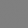<figcaption>Draw 1</figcaption></figure>
<figure>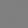<figcaption>Draw 2</figcaption></figure>
<figure>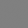<figcaption>Draw 3</figcaption></figure>
<figure>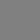<figcaption>Draw 4</figcaption></figure>
<figure>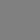<figcaption>Draw 5</figcaption></figure>
<figure>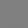<figcaption>Draw 6</figcaption></figure>

Epoch 0 · untrained initialization · fixed draws 1–6

::: {.fragment .takeaway data-fragment-index="0"}
Structure emerges in this run. Six images cannot establish quality or diversity across the generated distribution.
:::

Actual locally recorded outputs, not browser inference · first six fixed draws, no ranking or removal · 12,000 Fashion-MNIST training images; 60 epochs; seed 1205; Adam 0.0002, β=(0.5,0.999) · <a href="assets/evidence/section5/run.json">full protocol</a> · <a href="https://github.com/zalandoresearch/fashion-mnist">dataset source</a>.

::: {.notes}
Begin at initialization. Use epochs 1,5,20,60 and ask students what visible structure changes: foreground/background organization, silhouettes, and local texture. The six latent vectors and their ordering remain fixed; model parameters and G's BatchNorm running statistics change. Do not imply that a fixed latent draw preserves garment identity throughout training. All displays are evaluation-mode outputs from locally recorded checkpoints; the buttons do not train or run inference.

These are the first six normal draws from seed 1206, recorded at epochs 0,1,5,20,60 without sorting, cherry-picking, or removing failures. The data are the first 12,000 examples of the permutation used earlier (seed 41); category labels are unused. The initial 20-epoch run was extended to 60 after inspecting its rough outputs; the six draws and earlier snapshots were retained. Model initialization is seed 1205, minibatch order seed 1207, batch 128 with the final smaller batch retained, giving 94 alternating iterations per epoch. Each iteration uses one D step and one non-saturating G step. Both independent Adam optimizers have lr 0.0002 and betas (0.5,0.999). The source and final checkpoint preserve the run for reproduction.

Do not compare this gallery against the earlier MLP's untrained output as evidence that convolutions are superior: the training exposure is different and no trained MLP baseline was run. The purpose is to ground the architecture and update code in actual generated outputs. A single small run and six examples do not measure coverage, memorization, or stability. Any imperfect silhouettes remain visible. Reveal the takeaway after observation, setting up section 6's distinction between plausible individual samples and a good generated distribution.
:::

# Judging samples, diversity, and failure {.gan-section .gan-section-six background-color="#17212b" data-section-progress="06 / 06"}

::: {.notes}
About 12–15 minutes, including the closing exercise. Evaluate the actual course model without turning a small visual gallery into a population-level claim. Separate visible fidelity, variety, potential memorization, and the interpretation of training losses. Close by composing the mechanisms already taught; no new architecture or loss is introduced.
:::

## A plausible image is only one part of the job {#gan-evaluate-gallery .gan-s6}

Fresh batch<button type="button" data-eval-batch="0" aria-pressed="true">1</button><button type="button" data-eval-batch="1" aria-pressed="false">2</button><button type="button" data-eval-batch="2" aria-pressed="false">3</button><button type="button" id="gan-repeat-control" aria-pressed="false">Show repetition control</button>

<figure><figcaption>Held-out dataset images</figcaption>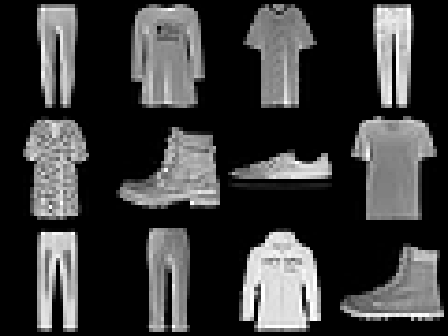</figure>
<figure><figcaption id="gan-eval-generated-label">Actual G · 12 fresh latent draws</figcaption>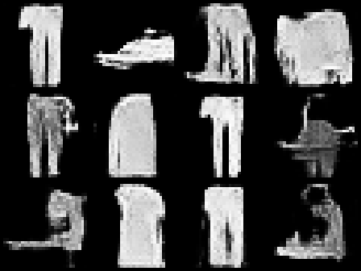</figure>

Recorded outputs · batch 1 of 3 · no selection by quality

::: {.fragment .takeaway data-fragment-index="0"}
Inspect both fidelity and variety. Mode collapse maps many latent codes to a narrow set of outputs.
:::

36 actual fresh outputs, seed 1208; three consecutive batches · held-out images were unseen during G/D training · repetition control deliberately duplicates one output; it is not observed collapse in this run · <a href="assets/evidence/section6/evaluation.json">protocol</a> · <a href="https://arxiv.org/abs/1511.01844">evaluation context: Theis et al., 2016</a>.

::: {.notes}
Inspect batch 1 before naming failure modes. Ask what looks garment-like and which structures look implausible or ambiguous. Move through all three batches, comparing visible variety with the real reference. These images are fresh standard-normal codes distinct from the six fixed training-viewer codes. Outputs are consecutive samples, not chosen by discriminator score or visual quality. The reference images are the first 36 held-out examples in the established split, not category-balanced selections.

Toggle the repetition control. The right gallery now repeats the first output of the selected batch twelve times. The caption and status explicitly mark it as constructed evidence, and the button offers a return to actual outputs. Ask what a single-image inspection would miss. Reveal fidelity versus variety and define mode collapse: many latent codes yield only a narrow subset of plausible possibilities. Exact duplication is the limiting case used for this controlled illustration, not a claim that this trained model has collapsed. Real collapse may still show small pixel variations.

Thirty-six outputs cannot establish category coverage, match of category frequencies, or absence of collapse across the latent distribution. The point is to inspect larger, uncurated batches instead of showing a few successes. Real-looking outputs can still miss modes; diverse-looking outputs can still be poor images. Image-by-image realism and distributional adequacy are distinct questions. Evaluation must serve the intended use, as emphasized by Theis et al. Do not introduce FID or another substantial new metric in the conclusion.
:::

## Training losses are diagnostics, not a quality score {#gan-evaluate-losses .gan-s6}

Checkpoint<button type="button" data-loss-checkpoint="5" aria-pressed="false">5</button><button type="button" data-loss-checkpoint="20" aria-pressed="true">20</button><button type="button" data-loss-checkpoint="60" aria-pressed="false">60</button>

D loss · sum of source meansG loss · non-saturating



<figure><figcaption>Same two latent draws</figcaption>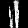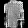<small id="gan-loss-checkpoint-values" aria-live="polite">Loading recorded loss values…</small></figure>

::: {.fragment .takeaway data-fragment-index="0"}
Both networks keep changing. Read the curves alongside fixed-code samples and fresh batches.
:::

Actual section 5 training record, all 60 epochs · losses measured on each network's own turn and averaged over minibatches · same shared vertical axis · <a href="assets/evidence/section6/losses.json">recorded values</a> · moving objectives: <a href="https://arxiv.org/abs/1406.2661">Goodfellow et al., 2014</a>.

::: {.notes}
The orange line is D's sum of real and generated source means; the blue line is the non-saturating G mean. These values are not directly comparable performance scores. Select checkpoints 5,20,60 and inspect the same two latent draws. The images are evaluation-mode recordings; the loss values are the epoch means collected during alternating training, not losses recomputed on these two images.

Ask whether a single lower point would be enough to choose a checkpoint. D changes the function against which G is judged, and G changes the negative examples D must recognize. Improvements in a source-classification objective do not necessarily track image fidelity or diversity. A discriminator score near 0.5 can arise from a weak discriminator as well as difficult discrimination, so it is not a certificate of distribution matching.

Use this actual record to practice relating curves to evidence, not to establish a universal shape of successful GAN training. Oscillation can be part of adversarial dynamics; one should inspect sample behavior, gradient/update correctness, and reproducibility before diagnosing instability from a curve alone. A sudden non-finite loss or absent required gradients would motivate implementation checks; section 4 supplied those checks. Keep several checkpoints and consistent fixed codes so changes can be examined rather than inferred from the final gallery.

The marker selects an epoch on the true horizontal axis. Every recorded epoch remains visible, without smoothing or cropping. The chart uses one shared zero-to-four y-axis. Two sample images are illustrative continuity evidence from the earlier six-draw viewer, not a benchmark or a selected best-pair claim.
:::

## Does “looks familiar” mean it was copied? {#gan-nearest-neighbors .gan-s6}

Three consecutive fresh outputs. Reveal each nearest image among <strong>12,000 training examples</strong>.



::: {.fragment .takeaway data-fragment-index="1"}
Nearest neighbors are a useful sanity check. Pixel distance alone cannot establish whether a model memorized.
:::

Actual outputs and exhaustive nearest-neighbor search · mean squared pixel error in [0,1], using original floating-point outputs · no query selection · <a href="assets/evidence/section6/evaluation.json">indices and distances</a> · training data: <a href="https://github.com/zalandoresearch/fashion-mnist">Fashion-MNIST</a>.

::: {.notes}
Ask students to inspect the generated images first. Reveal their nearest training images and exact pixel-MSE distances together. The queries are fresh draws 1,2,3 from the preceding gallery, not selected to illustrate either copying or novelty. The search covers all 12,000 training images with the original generated tensors; displayed PNGs are rounded only for visualization.

A match can help identify obvious copying or suspicious repeated templates. A different-looking nearest image is not proof of novelty, and a similar-looking nearest image is not proof of memorization. Aligned grayscale garments can be legitimately similar, while a translation or small deformation can produce substantial pixel distance. Our three query distances are observations, not thresholds for accepting the model. We do not claim a memorization test from a handful of visual pairs.

Reveal the limitation after students interpret the pairs. A broader audit would compare more uncurated samples and training versus held-out relationships under a similarity notion appropriate to the task. Do not turn that into an unexplained new metric here. This lecture establishes the discipline of asking what evidence supports a claim and preserving the experiment's limitations.

Connect the three checks: fresh batches probe visible variety and failures; fixed-code checkpoints expose changes over training; nearest-training-image inspection probes suspicious similarity. They answer different questions and do not replace one another. The last slide assembles this evaluation discipline with the generator, discriminator, losses, and update procedure already taught.
:::

## Assemble the system—and the evidence to judge it {#gan-final-synthesis .gan-s6}

Task: generate varied <strong>28 × 28 grayscale garments</strong> from random codes. You have unlabeled images and a held-out split. Specify the five parts below.

Data <strong>range + split?</strong>Hypothesis <strong>G and D?</strong>Loss <strong>targets?</strong>Optimization <strong>which weights?</strong>Evaluation <strong>what evidence?</strong>

PAUSE<b>90 seconds</b><small>State the sampling path too: which network is needed after training?</small>

WORKED SOLUTION · ONE COHERENT PIPELINE<table><tbody>
<tr><th>Data</th><td>Scale real images to [−1, 1]; keep a held-out reference.</td></tr>
<tr><th>Hypothesis</th><td>z → convolutional G → image → convolutional D → logit.</td></tr>
<tr><th>Loss</th><td>D targets: real 1, fake 0. G target: 1 through D.</td></tr>
<tr><th>Optimization</th><td>D turn: detach G output. G turn: keep the path through fixed D.</td></tr>
<tr><th>Evaluation</th><td>Fresh batches + fixed-code history + nearest training images.</td></tr>
</tbody></table>
<strong>Sampling:</strong> draw z → G in eval mode → image. D is a training partner.

Lecture synthesis · the objective, gradient paths, model shapes, and evidence checks have all been demonstrated · runnable reference: <a href="assets/conv_gan.py">convolutional GAN</a> and <a href="assets/build_section6.py">evaluation builder</a>.

::: {.notes}
Give the full pause. The task is unconditional generation, not selecting a requested garment category, so no conditioning machinery is needed. Students should combine the five familiar parts rather than list unrelated GAN facts. Encourage them to trace one D update, one G update, and one sampling call.

Reveal the complete worked solution. Data preprocessing and generator output range must agree. The convolutional architecture maps random codes into images and images into logits. The targets express the two distinct objectives. Optimizer ownership and gradient paths ensure the correct parameters change. Evaluation needs complementary evidence; neither a visually attractive single sample nor a low loss settles the task.

For the reference architecture, retain the BatchNorm policy explained in section 5. At sampling time use G.eval() and no_grad, then map Tanh outputs back into display range. D is unnecessary for this unconditional forward-generation path. The code reference includes those details; no new implementation contract is being introduced here.

Return to the opening problem: a random code has no paired target image. The learned discriminator supplies a differentiable training criterion; the generator learns an image-making mapping; alternating updates coordinate their competing goals. End with the responsibility to judge the resulting distribution using evidence appropriate to the task. The next scheduled course meetings are student project presentations, with exact presentation slots announced separately.
:::
